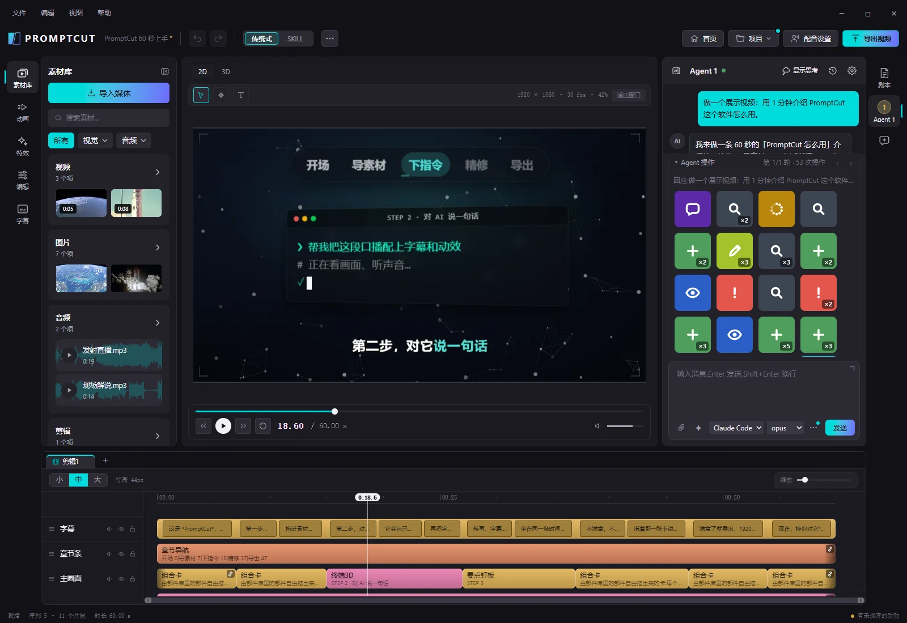

<p align="center">
  
</p>

<h1 align="center">PromptCut Community</h1>

<p align="center">
  <strong>Tell an AI agent how to cut your video, then take over by hand whenever you like.</strong>
</p>

<p align="center">
  <a href="README.md"></a>
  <a href="README.zh-CN.md"></a>
  <a href="README.ja.md"></a>
</p>

<p align="center">
  <a href="LICENSE"></a>
  <a href="https://github.com/Nice9Tian/PromptCut_Community/actions/workflows/test.yml"></a>
  
  
  <a href="CONTRIBUTING.en.md"></a>
</p>

<p align="center">
  <a href="#what-it-does">What it does</a> ·
  <a href="#getting-started">Getting started</a> ·
  <a href="#documentation">Documentation</a> ·
  <a href="CONTRIBUTING.en.md">Contributing</a>
</p>

<p align="center">
  
</p>

PromptCut is an AI video-editing workbench: you direct an agent in plain language, and you can also cut and tune parameters by hand — both at the same time, on the same project.

**This is the community edition**, for your own machine and your local network: the desktop app and a local browser. Another computer or a phone on the same network can scan a code to join a shared project and edit with you. There is nothing to sign up for. Website accounts, cloud projects, hosted services and the hosted web build stay in the closed commercial edition.

> [!NOTE]
> The app's interface is still Chinese-only today, as the screenshot shows. English and Japanese are in progress, see [issue #6](https://github.com/Nice9Tian/PromptCut_Community/issues/6).

## What it does

| | |
|---|---|
| **Agent-directed editing** | Talks to a local CLI or API agent that lays out the timeline, adds cards and tunes parameters. It also acts as an MCP server other agents can call. |
| **Manual editing** | Timeline, multiple tracks, nested cuts, parameter panels and preview. |
| **Cards** | Motion graphics, charts, captions and more, implemented as React components. A built-in library ships with the app, and you can write your own. |
| **Rendering and output** | Prerendered snapshots, frame-by-frame rendering in a local Chrome, and a final video composed with ffmpeg. |
| **Media** | Local import, fetching from web links (yt-dlp), shot-boundary detection, subject detection, point tracking and speech-to-text. |
| **LAN sharing** | Share a project on your local network. Another computer or a phone scans a code to join and both sides stay in sync. Phones get their own interface. |
| **Desktop app** | A Tauri v2 shell that packages Node, Chrome for Testing, ffmpeg and a bundled Python into a single Windows installer. |

## Getting started

You need Node.js ≥ 22 (24.x recommended). Exporting a final video also needs ffmpeg on `PATH` (on Windows: `winget install --id Gyan.FFmpeg -e`).

```bash
npm ci
npm run dev        # local editor at http://127.0.0.1:5190
```

| Command | What it does |
|---|---|
| `npm run dev` | Starts the local editor. The backend lives in this Vite dev server's plugin middleware, so the dev server is the app, not just a bundler. |
| `npm test` | Full unit-test suite |
| `npm run build` | Type-checks, then builds |
| `npx tsc -b` | Type-check only |

The Python side (speech-to-text, shot detection, subject detection, tracking, media collection) installs its dependencies and model weights on demand and reports honestly in `status` when something is missing. See [python/README.md](python/README.md). To build the desktop app, see [desktop/README.md](desktop/README.md).

## Documentation

The documentation is written in Chinese. `docs/semantics/` is the project's **contract**: where the semantics and the code disagree, the semantics win. Before changing code, use the table in [docs/semantics/README.md](docs/semantics/README.md) to find which documents govern your change.

| Topic | Where |
|---|---|
| Why the product exists, what it aims at | [docs/semantics/product-purpose.md](docs/semantics/product-purpose.md) |
| What the system is made of | [docs/semantics/architecture.md](docs/semantics/architecture.md); product-level promises in [product/](docs/semantics/product/), mechanisms in [mechanism/](docs/semantics/mechanism/) |
| How people use it | [docs/semantics/user-workflow.md](docs/semantics/user-workflow.md), details in [workflow/](docs/semantics/workflow/) |
| Glossary | [docs/semantics/glossary.md](docs/semantics/glossary.md) |
| Design rationale | [docs/rationale/](docs/rationale/) |
| Troubleshooting and operational know-how | [docs/guides/](docs/guides/) |
| How to contribute | [CONTRIBUTING.en.md](CONTRIBUTING.en.md) |

<details>
<summary><strong>References that point outside this repository</strong></summary>

Comments and semantics documents occasionally cite things this repository does not contain. There are two kinds:

- **Upstream internal documents**: `docs/plan/…` (plans and contracts), `docs/reports/…` (acceptance reports), and `docs/local.md` (per-machine notes, never committed to any repository by design, see `docs/semantics/guide_files/constraints.md`).
- **Commercial-edition-only code**: it lives under `cloud/` in the commercial repository (for example `cloud/src/account/…`, `cloud/server/hosted/…`; older comments may still use the pre-move paths `src/account/…`, `server/hosted/…`), plus compile-time constants like `ONLINE_BUILD` that are always false here.

Both kinds are kept deliberately: they record where a decision came from, and the comment itself already states the conclusion, so not being able to open the cited file does not stop you understanding the code. The local/cloud seam has been pulled apart: shared code only knows interfaces and registries, the commercial edition registers its own implementations from `cloud/`, and here those slots use the bundled local implementations.

</details>

<details>
<summary><strong>For coding agents</strong></summary>

This repository deliberately ships no `AGENTS.md` or `CLAUDE.md`: tools inject those files into context unconditionally, which would push this project's working habits into other people's agents. If you want one, create it in your working copy with the text below and do not commit it (`.gitignore` already covers it):

````markdown
# PromptCut

An AI video-editing workbench. Before changing this repository, know these things:

- The semantics live in `docs/semantics/`: product promises in `product/`, mechanisms in `mechanism/`, user flows in `workflow/`. Where semantics and code disagree, the semantics win.
- The hard constraints are in `docs/semantics/guide_files/constraints.md` and must be followed. Layering is kernel ← render ← editor / mcp / ai; lower layers never import upper ones, and a gatekeeper test enforces it.
- How to verify, and which check each kind of change must run, is in `docs/semantics/guide_files/verification.md`.
- Which semantics to read for a given change is in `docs/semantics/README.md`.
````

</details>

## License and name

The code is licensed under [MIT](LICENSE), but **the name "PromptCut" and the associated marks are not part of that license**. You are free to fork, modify and redistribute. Please do not call your distribution "PromptCut", so that users do not mistake it for an official release.
